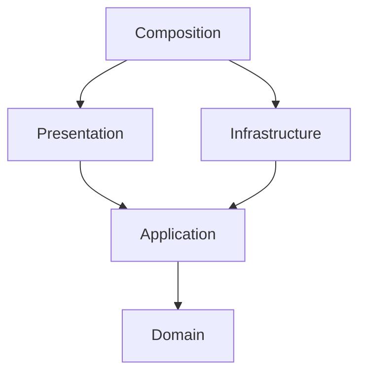

# Circuit routing context

Circuit Shift is a single-player tile rotation puzzle. Connect a source to every
lamp within a move budget. These are the planned M2 rules; M1 has no gameplay.
The model is a graph puzzle, not a simulation of electrical current.

| Term | Meaning and planned model |
| --- | --- |
| Cell | Value object: zero-based row and column within a rectangular board. |
| Port | Value: north, east, south or west edge of a tile. |
| Orientation | Value object: 0, 1, 2 or 3 clockwise quarter-turns from the base shape. |
| Tile | Immutable value object: base ports, orientation and role (source, wire or lamp). |
| Connection | Two adjacent tiles with facing ports: east meets west, north meets south. |
| Powered | Reachable from the source through zero or more Connections. |
| Board | Entity and aggregate: identity, tiles, move budget, moves used and state. |
| Rotation | Command to rotate a wire tile clockwise once, consuming one move. |
| TileRotated | Immutable domain event: board identity, Cell, new Orientation and move number. |
| BoardSolved | Immutable domain event emitted when a rotation first powers all lamps. |
| Connectivity | Pure domain service computing powered cells by graph traversal. |

A Board has exactly one source and at least one lamp. Source and lamp tiles are
fixed. Only wire tiles rotate; even a symmetric wire rotation costs one move.
Clockwise maps north to east, east to south, south to west, west to north.
Connections require reciprocal ports. Borders never wrap. Dangling ports and
cycles are allowed, but do not power a lamp unless it is connected to the source.

For example, on a one-row board, source {east}, wire {north,south}, lamp {west}
has an unpowered lamp. Rotating the wire once gives {east,west} and powers it.
A source {east} next to a wire {east} is not a Connection.

Board creation derives solved when every lamp is already powered; otherwise it
is active. A valid rotation emits TileRotated, then derives solved or exhausted
or active. Solving on the last move wins before exhaustion. BoardSolved follows
TileRotated only on the first transition to solved. Terminal boards reject
rotations. Invalid Cell or fixed-tile commands consume no move and emit no event.
Creation requires a positive move budget and rejects malformed boards.

The **Circuit Routing** bounded context owns tile orientation, connectivity,
move consumption, states and events. Real electronics, combat, territory, trade,
accounts, payments, multiplayer and generated level packs are outside it.
Fixed small boards come first. This differs from deduction and resource-market
games: the central rule is reciprocal graph connectivity after rotation.

## Dependency direction

Application owns use cases and repository ports. Infrastructure implements ports
with SQLite in M3. Presentation validates HTTP data with Pydantic; composition
alone wires adapters. The domain uses only the standard library. Import Linter
checks every package layer, adapter independence and the core's exclusion of
FastAPI, Pydantic, Uvicorn and SQLite. Tests import the core without site packages.

## References checked 2026-11-06

- [FastAPI first steps](https://fastapi.tiangolo.com/tutorial/first-steps/): application and route boundary.
- [FastAPI docs configuration](https://fastapi.tiangolo.com/tutorial/metadata/): disable optional CDN-backed documentation UIs.
- [Import Linter contracts](https://import-linter.readthedocs.io/en/stable/contract_types/layers/): layers and forbidden imports.
- [Import Linter configuration](https://import-linter.readthedocs.io/en/stable/get_started/configure/): external packages are included in the graph.

These references describe the tools. The puzzle rules above are this project's design.
