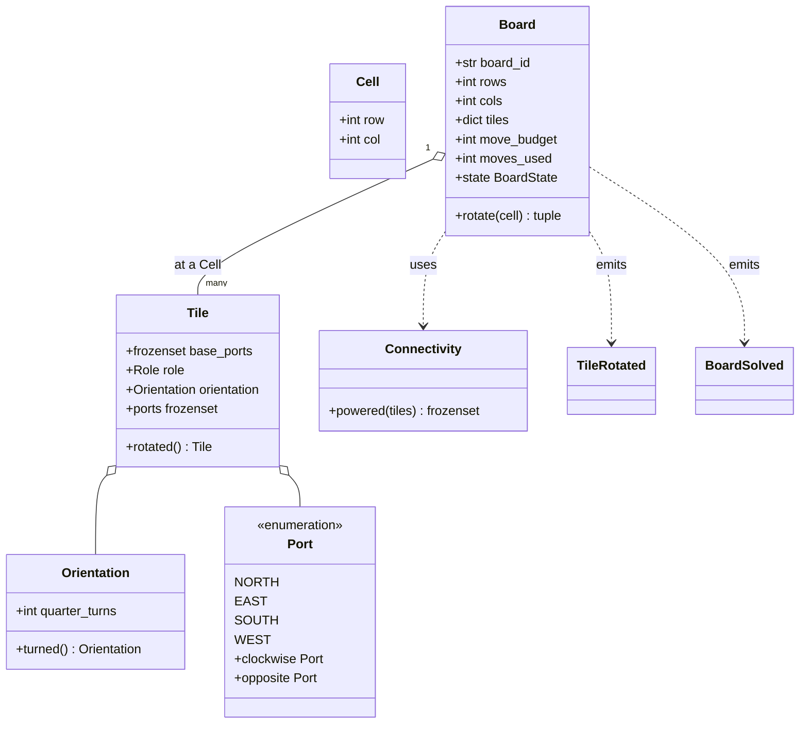
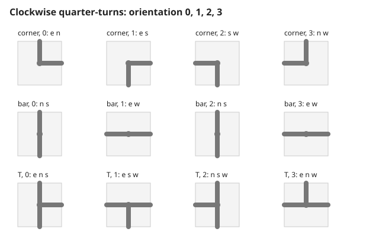
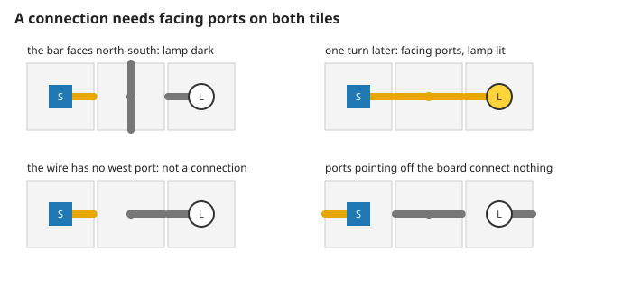
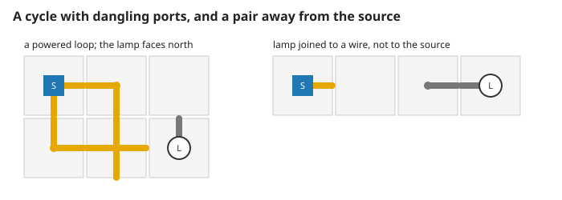
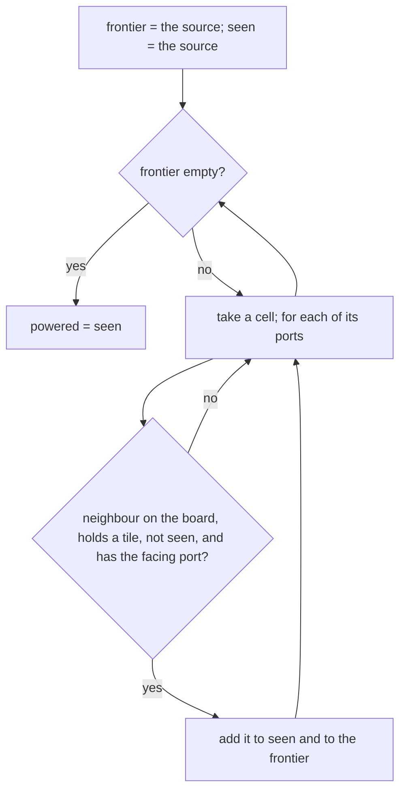

# 1. Tiles, connections and power

A tile-rotation puzzle on a grid: connect one source to every lamp. It is a graph puzzle, not a simulation of electric current. Measured numbers are quoted by their id in [figures/values.md](figures/values.md).

[Back to the index](README.md)

## S01 — The language of the game

**Statement.** Eleven terms, each with one meaning:

| Term | Meaning |
|---|---|
| Cell | a position: zero-based row and column |
| Port | a side of a tile where a wire leaves: north, east, south or west |
| Orientation | 0, 1, 2 or 3 clockwise quarter-turns from the tile's base shape |
| Tile | base ports, an orientation and a role: source, wire or lamp |
| Connection | two neighbouring tiles whose facing ports both exist |
| Powered | reachable from the source through connections |
| Board | one puzzle: tiles on a rectangle, a move budget, moves used, a state |
| Rotation | the only command: turn one wire tile clockwise once, for one move |
| TileRotated | the record of a rotation: board, cell, new orientation, move number |
| BoardSolved | the record that a rotation first powered every lamp |
| Connectivity | the rule that finds the powered cells |

**Assumptions and where they break.** One player, one board at a time, no clock. Nothing is random.

**Derivation.** Definitions; the code uses the same words as class names.

**Code.** `src/circuit_shift/domain/model.py`: `Cell`, `Port`, `Orientation`, `Tile`, `Role`, `Connectivity`, `Board`, `BoardState`, `TileRotated`, `BoardSolved`, the union `Event`, the exceptions `BoardFinished` and `InvalidRotation`, and the helpers `tile` and `starter_board`.

**Tests.** `test_REQ_CONNECT_documented_one_row_example` in `tests/test_domain.py` builds these objects and compares the events by value.

## S02 — Ports turn clockwise

**Statement.** A quarter-turn maps every port of a tile by

$$\text{north} \to \text{east} \to \text{south} \to \text{west} \to \text{north},$$

and a tile's ports are its base ports turned as many times as its orientation says. Four turns give the tile back. A corner has four different orientations, a straight bar two, a cross one — and a turn that changes nothing visible still costs a move (S06).

**Assumptions and where they break.** Orientations are whole numbers 0 to 3; rotating a tile makes a new tile and never changes the old one.

**Derivation.** The four sides form a cycle of length four; turning is a shift along it, so the map has order four. A shape is unchanged by a turn exactly when its set of ports is invariant under the shift.

**Code.** `Port.clockwise`, `Port.opposite`, `Port.step`, `Orientation.turned`, `Tile.ports` and `Tile.rotated` in `src/circuit_shift/domain/model.py`.

**Tests.** `test_REQ_TILE_clockwise_and_opposite_ports`, `test_REQ_TILE_all_four_orientations`, `test_REQ_TILE_rotation_gives_a_new_value_and_wraps_after_four`, `test_REQ_TILE_orientation_is_zero_to_three`. Measured: `turn-cycle` = 1, `turn-ports` = 1; `turn-distinct-corner` = 4, `turn-distinct-bar` = 2, `turn-distinct-cross` = 1; `orientation-rejected` = 4 of 4.

## S03 — A connection needs both sides

**Statement.** Two tiles are connected exactly when they are neighbours in a row or a column **and** each has a port on the side facing the other: east meets west, north meets south. A port that faces an empty cell, the edge of the board, or a tile without the matching port connects nothing. The board does not wrap round.

**Assumptions and where they break.** Only the four orthogonal neighbours; no diagonal connections, no crossing without joining (a cross joins all four sides).

**Derivation.** A design rule; it makes "connected" a symmetric relation, so the tiles and connections form an undirected graph.

**Code.** The loop of `Connectivity.powered` in `src/circuit_shift/domain/model.py`: for each port of a tile it steps to the neighbour (`Cell.towards`), skips negative coordinates and empty cells, and requires `port.opposite` among the neighbour's ports.

**Tests.** `test_REQ_CONNECT_documented_one_row_example`, `test_REQ_CONNECT_ports_must_be_reciprocal`, `test_REQ_CONNECT_borders_do_not_wrap`. Measured on the four boards of the figure: `connect-example-dark` = 0, `connect-example-lit` = 1, `connect-one-sided` = 0, `connect-no-wrap` = 0.

## S04 — Powered means reachable from the source

**Statement.** A cell is powered when a path of connections (S03) leads to it from the source. The powered set is the connected component of the source in the graph of S03, found by graph traversal. Cycles are allowed and harmless; dangling ports are allowed; a lamp joined to wires that are not joined to the source is not powered. The board is solved when every lamp is powered.

**Assumptions and where they break.** One source (S05). "Power" has no strength and no direction: a lamp at the end of a long path is as powered as one next to the source.

**Derivation.** Reachability in an undirected graph: start from the source, repeatedly add unvisited neighbours across connections, stop when none is left. Each cell is added at most once, so the traversal ends after at most as many steps as there are tiles, and a cycle only means a cell is found twice and added once.

**Code.** `Connectivity.powered`, `Board.powered` and `Board.lamps` in `src/circuit_shift/domain/model.py`.

**Tests.** `test_REQ_CONNECT_cycles_and_dangling_ports_are_allowed`, `test_REQ_CONNECT_every_lamp_must_be_reached`. Measured on the two boards of the figure: `connect-cycle` = 4 powered tiles (the loop, not the lamp) and `connect-island` = 1 (the source alone).

## References

- T. H. Cormen, C. E. Leiserson, R. L. Rivest, C. Stein, *Introduction to Algorithms*, 3rd ed., MIT Press, 2009, §22.2–22.3 — graph traversal and reachability.
