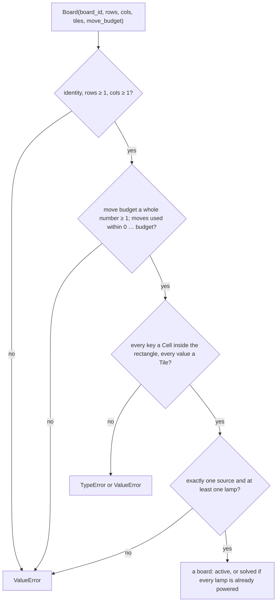
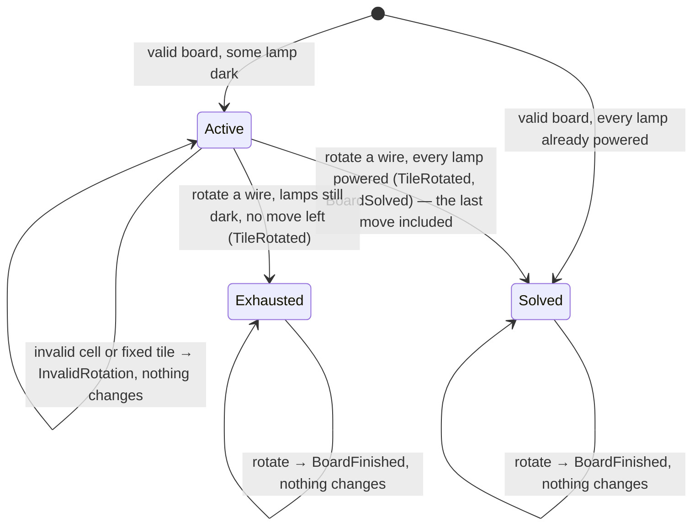
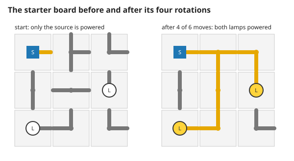
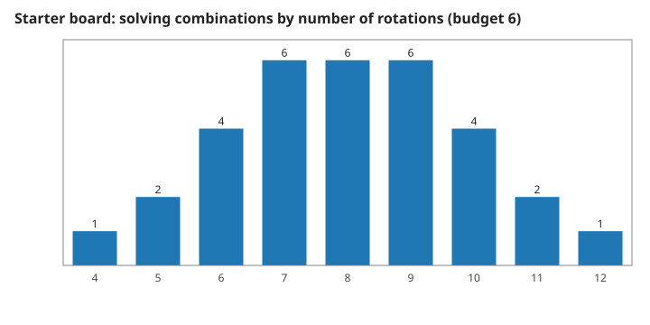
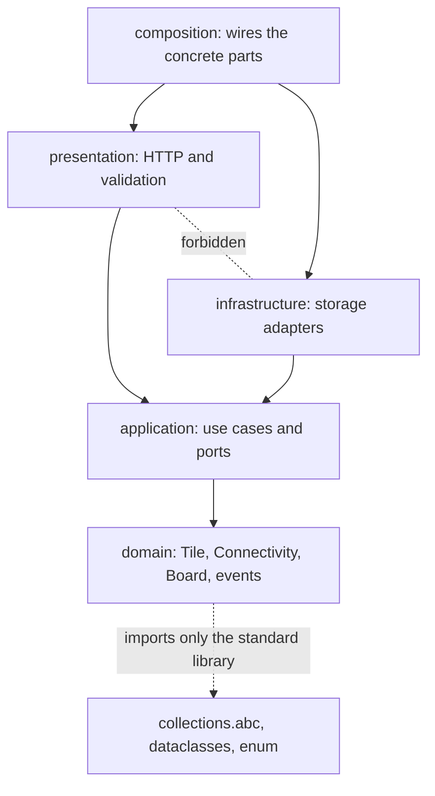

# 2. The board, its moves, and where the rules live

What makes a board valid, what one rotation does, how a puzzle ends, and why the rules do not depend on the web framework. Measured numbers are quoted by their id in [figures/values.md](figures/values.md).

[Back to the index](README.md)

## S05 — A valid board

**Statement.** A board is accepted only if it has an identity; at least one row and one column; a move budget that is a positive whole number; every tile on a cell inside the rectangle; **exactly one source**; and **at least one lamp**. Cells may be empty. A board whose lamps are all powered at creation is solved from the start.

**Assumptions and where they break.** Validity says nothing about solvability: a valid board can be impossible within its budget, or at all. The starter board is checked for that separately (S07).

**Derivation.** A design rule: with one source, "powered" (S04) has one meaning; with no lamp there would be nothing to solve.

**Code.** `Board.__post_init__` in `src/circuit_shift/domain/model.py`.

**Tests.** `test_REQ_BOARD_creation_rejects_malformed_boards` (ten kinds), `test_REQ_BOARD_a_board_can_start_solved_and_then_rejects_rotation`. Measured: `board-rejected` = 5 of 5 — no source, two sources, no lamp, a budget of zero, a tile off the board.

## S06 — One rotation: a move, a new state, events

**Statement.** `rotate(cell)` does, in this order: refuse if the board is solved or exhausted; refuse if the cell is off the board, empty, or holds the source or a lamp; replace the wire by itself turned once (S02); count one move; and return `TileRotated`, followed by `BoardSolved` if every lamp is now powered. A refused call changes nothing and costs no move.

The state is derived, never stored: **solved** when every lamp is powered — checked first, so solving on the last move wins; otherwise **exhausted** when the moves used reach the budget; otherwise **active**.

**Assumptions and where they break.** Every accepted rotation costs one move, even one that changes nothing visible (a cross). There is no undo: turning a tile back takes three more moves.

**Derivation.** A design rule: every check happens before the first change. Because a solved board accepts no rotation, `BoardSolved` can be emitted only once.

**Code.** `Board.rotate` and `Board.state` in `src/circuit_shift/domain/model.py`; the events `TileRotated` and `BoardSolved`; the exceptions `BoardFinished` and `InvalidRotation`.

**Tests.** `test_REQ_BOARD_symmetric_rotation_still_costs_a_move`, `test_REQ_BOARD_solving_on_the_last_move_wins`, `test_REQ_BOARD_running_out_of_moves_exhausts_and_rejects`, `test_REQ_BOARD_invalid_commands_cost_nothing`, `test_REQ_BOARD_solved_event_only_on_the_first_transition`. Measured: `last-move-wins` = 1, `budget-exhausts` = 1, `terminal-refuses` = 1 with `terminal-moves` = 2 unchanged; `invalid-refused` = 4 of 4 with `invalid-free` = 0 moves used.

## S07 — The starter board can be solved, in four moves

**Statement.** The fixed 3 × 3 starter board has one source, two lamps and six wires (two of them decoys) and a budget of six moves. Of the $4^6 = 4096$ combinations of wire orientations, 32 power both lamps; the cheapest needs **four** rotations, and 7 combinations lie within the budget. Four is also the length of the shortest sequence of legal moves.

**Assumptions and where they break.** The counts are for this board. A combination's cost is the total number of quarter-turns from the starting orientations; since moves only turn clockwise, that is exactly the number of moves needed to reach it.

**Derivation.** Not derived but computed, two ways: by trying every combination of orientations, and by a breadth-first search over sequences of rotations played through the `Board` aggregate. They agree.

**Code.** `starter_board` and the shorthand `tile` in `src/circuit_shift/domain/model.py`.

**Tests.** `test_REQ_BOARD_starter_needs_four_rotations_found_by_search`, `test_REQ_BOARD_same_commands_give_the_same_board`. Measured: `starter-wires` = 6, `starter-powered-start` = 1; `starter-combos` = 4096, `starter-solutions` = 32, `starter-minimum` = 4, `starter-within-budget` = 7, `starter-shortest-play` = 4; playing the four moves gives `starter-events` = 5 events of which `starter-solved-events` = 1 is BoardSolved, with move numbers 1 to 4 (`starter-moves`), and the board is solved (`starter-solved`).

## S08 — The rules do not know about the web

**Statement.** The code is in four layers, and imports point inward only:

$$\text{composition} \;\to\; \{\text{presentation},\ \text{infrastructure}\} \;\to\; \text{application} \;\to\; \text{domain} .$$

Presentation and infrastructure do not import each other. The domain and the application import none of FastAPI, Pydantic, Uvicorn and sqlite3; the domain uses the standard library only.

**Assumptions and where they break.** The rule is about import statements; the second test below, which imports the core with third-party packages unavailable, also catches an import hidden inside a function for packages outside the standard library.

**Derivation.** If the rules import nothing from the outer layers, they can be run, tested and reasoned about without a server or a database — every figure in this handbook was drawn that way — and the framework or the storage can change without touching them [Evans 2003, ch. 4; Martin 2017, ch. 22].

**Code.** The two Import Linter contracts in `pyproject.toml` (`Adapters point inward and remain independent`, `Core excludes web frameworks, validation and storage adapters`); `src/circuit_shift/domain/__init__.py` exports the fifteen names of S01.

**Tests.** `make check` runs Import Linter (2 contracts kept); `test_REQ_CORE_imports_without_site_packages` in `tests/test_scaffold.py` starts Python with site packages disabled and imports the domain and the application.

## References

- E. Evans, *Domain-Driven Design*, Addison-Wesley, 2003.
- R. C. Martin, *Clean Architecture*, Prentice Hall, 2017.
