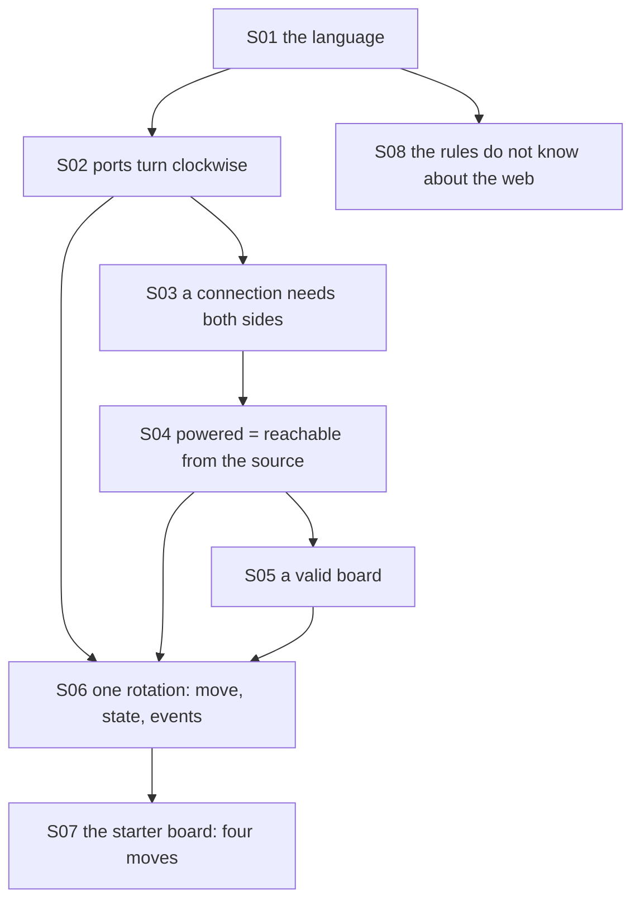

# Theory handbook

Why the program is correct, from the repository alone: every rule and invariant the code relies on, each stated in Markdown **with a figure**, the place in the code that implements it, and the test or measurement that checks it.

- Drawn figures and the numbers quoted in the text are produced by the domain itself: `make theory-figs` rewrites [figures/](figures/) and [figures/values.md](figures/values.md) (under a second). Boards are drawn from the same `Tile` and `Connectivity` the game uses; other diagrams are Mermaid, written in the pages.
- `make theory-check` fails when a statement has no figure, a link is broken, a referenced function, test or measured value no longer exists, or a name exported by the domain is missing from the table below.

## Pages

1. [Tiles, connections and power](01-tiles-and-connections.md) — the language, clockwise ports, what a connection is, powered as reachability
2. [The board, its moves, and where the rules live](02-board-and-layers.md) — a valid board, one rotation and the three states, the starter board's solutions, the dependency rule

## How the pieces depend on each other

## Coverage: statement → page → figure → code → test

| ID | Statement | Page | Figure | Code | Test |
|---|---|---|---|---|---|
| S01 | The language of the game | [1](01-tiles-and-connections.md) | mermaid | `src/circuit_shift/domain/model.py#Cell`, `src/circuit_shift/domain/model.py#Role`, `src/circuit_shift/domain/model.py#Event`, `src/circuit_shift/domain/model.py#BoardState` | `tests/test_domain.py#test_REQ_CONNECT_documented_one_row_example` |
| S02 | Ports turn clockwise through four orientations | [1](01-tiles-and-connections.md) | `figures/orientations.svg` | `src/circuit_shift/domain/model.py#Port`, `src/circuit_shift/domain/model.py#Orientation`, `src/circuit_shift/domain/model.py#Tile` | `tests/test_domain.py#test_REQ_TILE_all_four_orientations`, `tests/test_domain.py#test_REQ_TILE_rotation_gives_a_new_value_and_wraps_after_four` |
| S03 | A connection needs facing ports; no wrapping | [1](01-tiles-and-connections.md) | `figures/connections.svg` | `src/circuit_shift/domain/model.py#def towards`, `src/circuit_shift/domain/model.py#Connectivity` | `tests/test_domain.py#test_REQ_CONNECT_ports_must_be_reciprocal`, `tests/test_domain.py#test_REQ_CONNECT_borders_do_not_wrap` |
| S04 | Powered = reachable from the source | [1](01-tiles-and-connections.md) | `figures/graph.svg`, mermaid | `src/circuit_shift/domain/model.py#def powered` | `tests/test_domain.py#test_REQ_CONNECT_cycles_and_dangling_ports_are_allowed` |
| S05 | A valid board: one source, a lamp, a positive budget | [2](02-board-and-layers.md) | mermaid | `src/circuit_shift/domain/model.py#Board` | `tests/test_domain.py#test_REQ_BOARD_creation_rejects_malformed_boards` |
| S06 | One rotation: a move, the derived state, the events | [2](02-board-and-layers.md) | mermaid | `src/circuit_shift/domain/model.py#def rotate`, `src/circuit_shift/domain/model.py#TileRotated`, `src/circuit_shift/domain/model.py#BoardSolved`, `src/circuit_shift/domain/model.py#BoardFinished`, `src/circuit_shift/domain/model.py#InvalidRotation` | `tests/test_domain.py#test_REQ_BOARD_solving_on_the_last_move_wins`, `tests/test_domain.py#test_REQ_BOARD_invalid_commands_cost_nothing` |
| S07 | The starter board is solvable in four moves | [2](02-board-and-layers.md) | `figures/starter.svg`, `figures/solutions.svg` | `src/circuit_shift/domain/model.py#starter_board`, `src/circuit_shift/domain/model.py#tile(` | `tests/test_domain.py#test_REQ_BOARD_starter_needs_four_rotations_found_by_search`, `scripts/theory_figs.py#starter-shortest-play` |
| S08 | Layers and the inward dependency rule | [2](02-board-and-layers.md) | mermaid | `pyproject.toml#Adapters point inward and remain independent`, `src/circuit_shift/application/ports.py`, `src/circuit_shift/infrastructure/repository.py`, `src/circuit_shift/composition.py` | `tests/test_scaffold.py#test_REQ_CORE_imports_without_site_packages`, `tests/test_persistence.py#test_REQ_PERSISTENCE_state_and_ordered_events_survive_reopen` |

Tests named `scripts/theory_figs.py#…` are measurements recorded in [figures/values.md](figures/values.md) by `make theory-figs`, not assertions of `make check`.

## Reading the source against this table

Reviewed for this handbook: all of `src/circuit_shift/domain/model.py` (the fifteen names exported by `src/circuit_shift/domain/__init__.py`), the two Import Linter contracts in `pyproject.toml`, the application port, SQLite repository and composition wiring, and the domain, application and persistence tests. Presentation remains a health-only adapter; playable routes are M4.

The program is unchanged by this handbook: it adds `scripts/theory_figs.py`, `scripts/theory_check.py`, two Makefile targets, one Ruff per-file setting and these pages.
